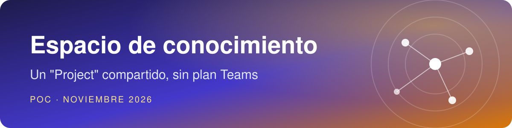
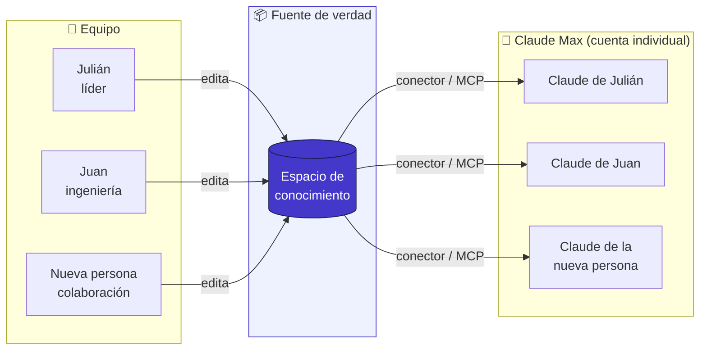

  

  
  
  
  

# 🧭 Espacio de conocimiento compartido

> **La idea en una línea:** una sola fuente de verdad que las tres personas del equipo editan, y que cada uno le entrega a su propio Claude como si fuera el *knowledge* de un Project de Teams.

> [!NOTE]
> Este repositorio es una **prueba de concepto**. El contenido es ilustrativo: lo que se evalúa es la **presentación** y el **flujo de trabajo**, no la exactitud de cada dato.

---

## 📚 Contenido

| # | Documento | De qué trata | Estado |
|:-:|-----------|--------------|:------:|
| 1 | [Contexto del proyecto](docs/01-contexto-del-proyecto.md) | Visión, objetivos, equipo y hoja de ruta | 🟢 Listo |
| 2 | [Comparativa de plataformas](docs/02-comparativa-plataformas.md) | OneDrive, Google Drive, GitHub y Confluence frente a frente | 🟢 Listo |
| 3 | [Registro de decisiones](docs/03-registro-de-decisiones.md) | Qué decidimos, cuándo y por qué | 🟡 Borrador |
| 4 | [Cómo usarlo con Claude](docs/04-como-usarlo-con-claude.md) | El flujo diario para que Claude lea el espacio | 🟡 Borrador |

---

## 🔄 Cómo funciona

En Teams y Enterprise, un **Project** se comparte y todos ven el mismo conocimiento. En Max cada cuenta es una isla. La salida es **sacar el conocimiento de Claude** y ponerlo en un lugar que todos editan; cada Claude lo lee por su cuenta.

---

## ⚖️ Project de Teams vs. esta PoC

| Capacidad | Project (Teams / Enterprise) | Esta PoC (Max) |
|-----------|:----------------------------:|:--------------:|
| Conocimiento compartido | ✅ | ✅ |
| Instrucciones comunes del proyecto | ✅ | ✅ *(un archivo `INSTRUCCIONES.md`)* |
| Historial de versiones | ⚠️ limitado | ✅ completo |
| Ver los chats de los demás | ✅ | ❌ |
| Costo adicional | 💲💲 por puesto | 🆓 o casi |
| Funciona fuera de Claude | ❌ | ✅ |

> [!TIP]
> El historial de chats no se comparte, pero **las conclusiones sí**: si una conversación produce algo valioso, se escribe en el espacio y los demás lo heredan.

---

## 🚀 Primeros pasos

- [x] Elegir los documentos semilla
- [x] Montar el ejemplo en GitHub
- [x] Montar el ejemplo en Google Docs
- [x] Montar el ejemplo en Confluence
- [ ] Presentarlo en la reunión
- [ ] Elegir **una** plataforma
- [ ] Invitar a la nueva persona

<b>❓ ¿Por qué Markdown como formato base?</b>

 

Porque es el formato que mejor lee Claude, se versiona en git sin fricción y se convierte a casi cualquier cosa: Google Docs, Confluence, PDF o una página web. Si mañana cambiamos de plataforma, el contenido viaja con nosotros.

---

Hecho con ☕ para la reunión del 19 de noviembre de 2026

