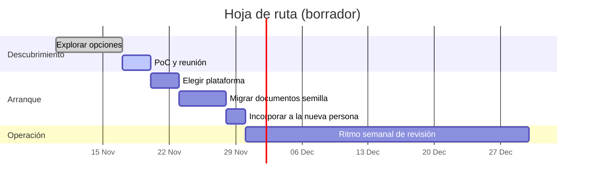

# 🎯 Contexto del proyecto

> [← Volver al inicio](../README.md)

## Visión

> *"Que cualquier persona del equipo, y su Claude, pueda arrancar una conversación sabiendo exactamente dónde estamos."*

El proyecto lo lidera **Julián**. Sumamos a una tercera persona y necesitamos que las tres trabajemos sobre el mismo contexto sin pagar un plan Teams mientras validamos la idea.

## Objetivos

| Objetivo | Indicador | Meta | Plazo |
|----------|-----------|:----:|:-----:|
| 🧠 Contexto compartido | Documentos vivos en el espacio | ≥ 10 | Dic 2026 |
| ⚡ Arranque rápido | Minutos para que alguien nuevo entienda el proyecto | < 15 | Dic 2026 |
| 🔁 Sin duplicados | Versiones contradictorias de un mismo dato | 0 | Siempre |
| 💸 Costo controlado | Gasto mensual en la herramienta | $0 | Q1 2027 |

## 👥 Equipo

| | Persona | Rol | Responsable de |
|:-:|---------|-----|----------------|
| 🧑‍💼 | **Julián** | Líder del proyecto | Visión, prioridades, aprobación |
| 👨‍💻 | **Juan** | Ingeniería | Estructura del espacio, automatización, integraciones |
| 🧑‍🎨 | **Nueva persona** | Colaboración | *Por definir en la reunión* |

## 🗺️ Hoja de ruta

## Principios de trabajo

1. **Una sola fuente de verdad.** Si algo vive en dos lugares, uno de los dos está mal.
2. **Escribir para el que llega mañana.** Cada documento se entiende sin haber estado en la reunión.
3. **Claude lee, las personas deciden.** Claude propone; la decisión queda escrita con nombre y fecha.
4. **Poco y vivo antes que mucho y viejo.**

> [!IMPORTANT]
> Todo lo que se decida en una conversación con Claude y afecte al equipo **se escribe aquí**. Si no está escrito, no pasó.

## Glosario

| Término | Significado |
|---------|-------------|
| **Project** | Función de Claude que agrupa chats con un conocimiento e instrucciones comunes. Compartible solo en Teams/Enterprise. |
| **Espacio** | El lugar (repo, carpeta o espacio de Confluence) donde vive el conocimiento compartido. |
| **MCP** | *Model Context Protocol*: el mecanismo por el que Claude se conecta a herramientas externas. |
| **Fuente de verdad** | El único documento que vale cuando dos versiones no coinciden. |
