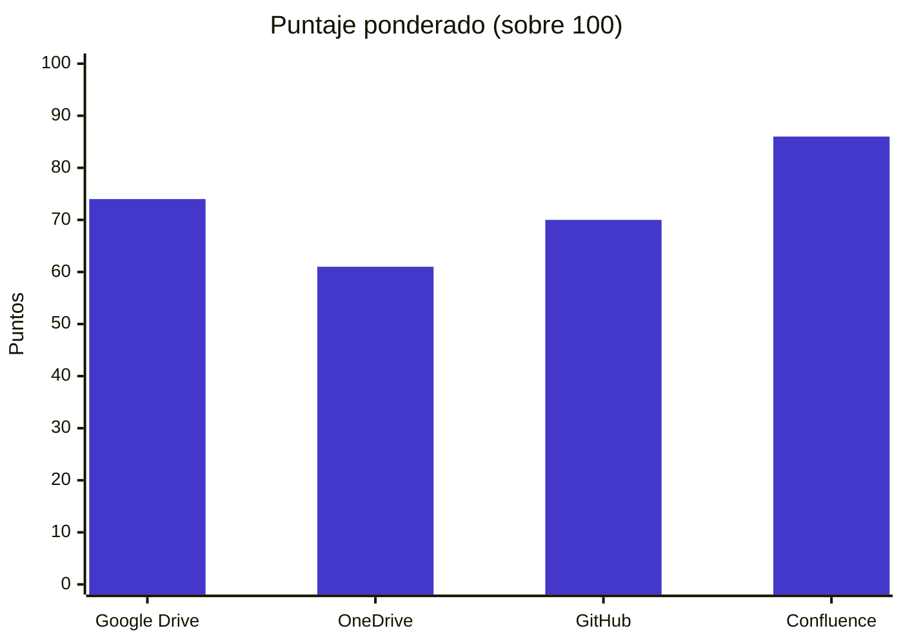
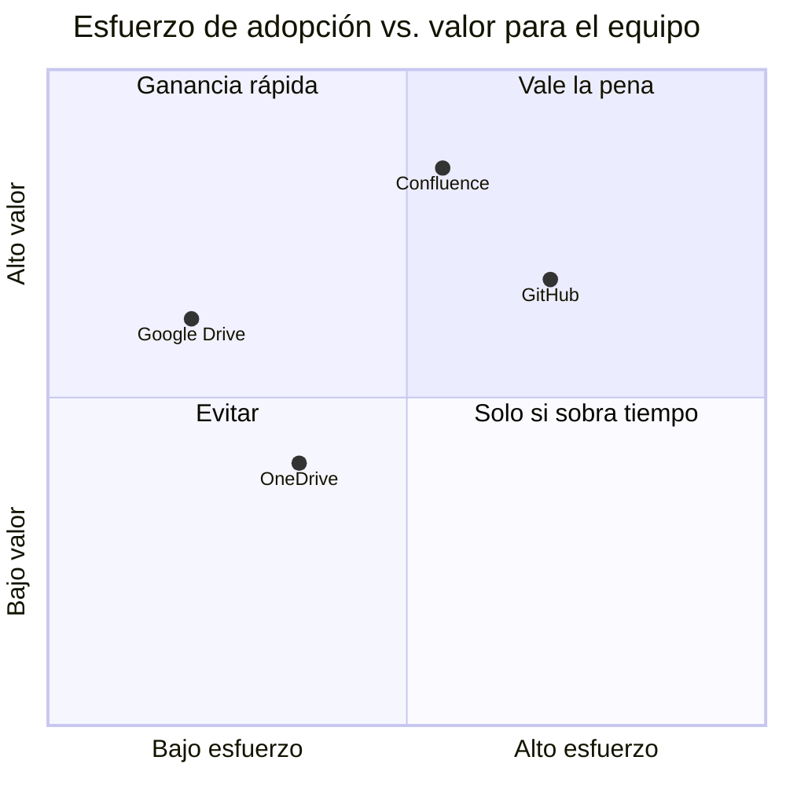

# ⚖️ Comparativa de plataformas

> [← Volver al inicio](../README.md)

Cuatro candidatas para alojar el espacio de conocimiento. La pregunta no es cuál es mejor en general, sino **cuál le sirve a un equipo de tres con cuentas Claude Max**.

## Vista rápida

| Criterio |  Google Drive |  OneDrive |  GitHub |  Confluence |
|----------|:---:|:---:|:---:|:---:|
| Conector nativo en Claude | ✅ | ⚠️ | ✅ | ✅ |
| Edición fácil para no técnicos | ⭐⭐⭐⭐⭐ | ⭐⭐⭐⭐ | ⭐⭐ | ⭐⭐⭐⭐ |
| Historial de versiones | ⭐⭐⭐ | ⭐⭐⭐ | ⭐⭐⭐⭐⭐ | ⭐⭐⭐⭐ |
| Estructura y navegación | ⭐⭐ | ⭐⭐ | ⭐⭐⭐ | ⭐⭐⭐⭐⭐ |
| Plan gratuito suficiente | ✅ | ✅ | ✅ | ✅ *(hasta 10 usuarios)* |
| Curva de aprendizaje | Baja | Baja | Media | Media |

✅ sí · ⚠️ parcial · ❌ no — valoraciones del equipo, no mediciones.

## Puntaje ponderado

## Detalle por opción

<b>📁 Google Drive</b>: lo que todos ya conocen

 

**A favor**
- Cero curva de aprendizaje.
- Conector oficial en Claude.
- Comentarios y sugerencias excelentes.

**En contra**
- Los documentos se pierden en carpetas; no hay navegación de "wiki".
- Fácil terminar con `Copia de Copia de Contexto (final) v2`.

<b>☁️ OneDrive</b>: si el equipo vive en Microsoft 365

 

**A favor**
- Integrado con Word, Teams y Outlook.

**En contra**
- Nadie del equipo lo usa a diario.
- Soporte en Claude menos directo.

<b>🐙 GitHub</b>: Markdown puro y versionado perfecto

 

**A favor**
- Historial completo, *diffs* y revisiones.
- Markdown es el formato nativo de Claude.
- Claude Code trabaja directamente sobre el repo.

**En contra**
- Intimidante para quien no programa.
- Editar desde el navegador funciona, pero no se siente como un documento.

<b>📘 Confluence</b>: una wiki de verdad

 

**A favor**
- Árbol de páginas, plantillas, menciones, tareas.
- Macros visuales: paneles, estados, índices.
- Juan ya lo usa a diario.
- Conector oficial de Atlassian para Claude.

**En contra**
- Atlassian insiste con correos para pasar a pago.
- El plan gratuito tiene límites de almacenamiento y de permisos finos.

## Recomendación

> [!TIP]
> **Confluence como espacio principal**, con la opción de exportar a Markdown si algún día migramos. Para tres personas el plan gratuito alcanza con holgura.

> [!WARNING]
> Los correos de Atlassian pidiendo datos de pago son **comerciales**: el plan Free no vence. Conviene revisar los límites vigentes antes de decidir.

## Matriz esfuerzo / valor

