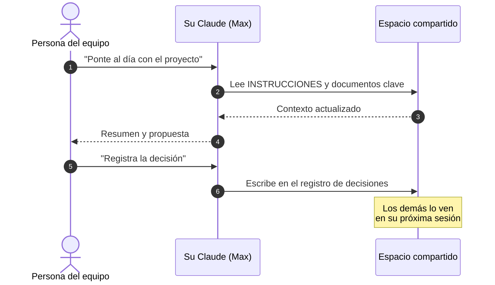

# 🤖 Cómo usarlo con Claude

> [← Volver al inicio](../README.md)

## El flujo en tres pasos



## Conectar Claude al espacio

| Plataforma | Dónde se conecta | Qué puede hacer Claude |
|------------|------------------|------------------------|
| Google Drive | claude.ai → Configuración → Conectores | Buscar, leer y crear documentos |
| GitHub | Conector de GitHub o Claude Code | Leer el repo; con Claude Code, editar y hacer *commits* |
| Confluence | Conector de Atlassian | Buscar, leer, crear y editar páginas |

## Instrucciones comunes

El equivalente a las *Project instructions* es un documento que todos le piden a Claude leer primero:

```text
Eres parte del equipo del proyecto. Antes de responder:
1. Lee "Contexto del proyecto" y "Registro de decisiones".
2. Si algo contradice una decisión aceptada, avísalo.
3. Cuando el equipo tome una decisión, propón el texto para el registro.
Responde en español, con frases cortas.
```

## Frases útiles

| Para… | Dile a Claude |
|-------|---------------|
| Ponerse al día | *"Lee el espacio del proyecto y dime qué cambió esta semana."* |
| Preparar una reunión | *"Arma la agenda a partir de las decisiones en estado Propuesta."* |
| Registrar algo | *"Agrega esta decisión al registro con mi nombre y la fecha de hoy."* |
| Revisar coherencia | *"¿Hay algo en los documentos que se contradiga?"* |

> [!CAUTION]
> Claude puede escribir en el espacio si el conector lo permite. Revisa lo que propone antes de aceptarlo: **lo escrito ahí lo leen los Claude de los demás**.

## Preguntas frecuentes

**¿Se comparten los chats?**
No. Cada cuenta Max ve solo sus chats. Lo que se comparte es el espacio[^1].

**¿Y si dos personas editan a la vez?**
Google Docs y Confluence lo manejan en tiempo real. En GitHub se resuelve con *pull requests*.

**¿Cuánto cuesta?**
Con los planes gratuitos de cualquiera de las cuatro opciones, nada adicional a las cuentas Max.

[^1]: Es la diferencia principal con un Project de Teams, donde el conocimiento y las instrucciones viven dentro de Claude.
